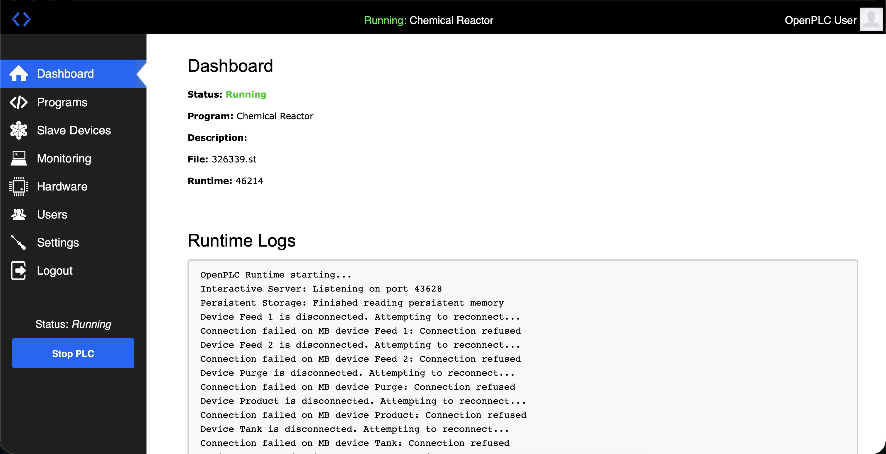
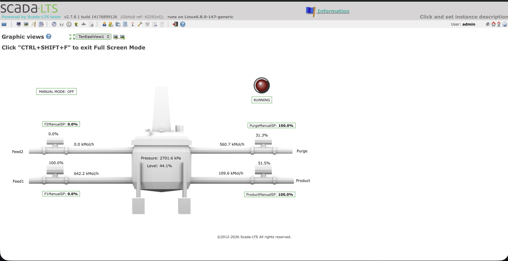
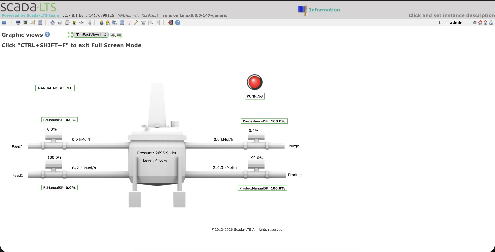
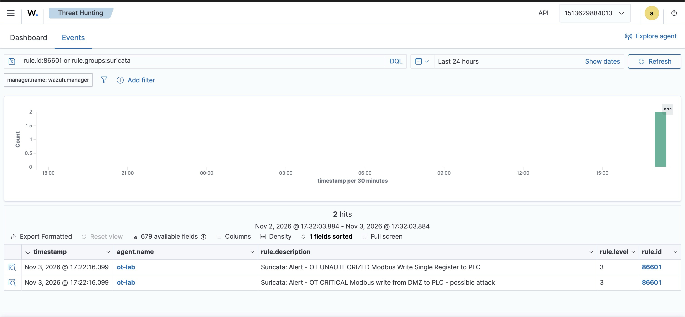
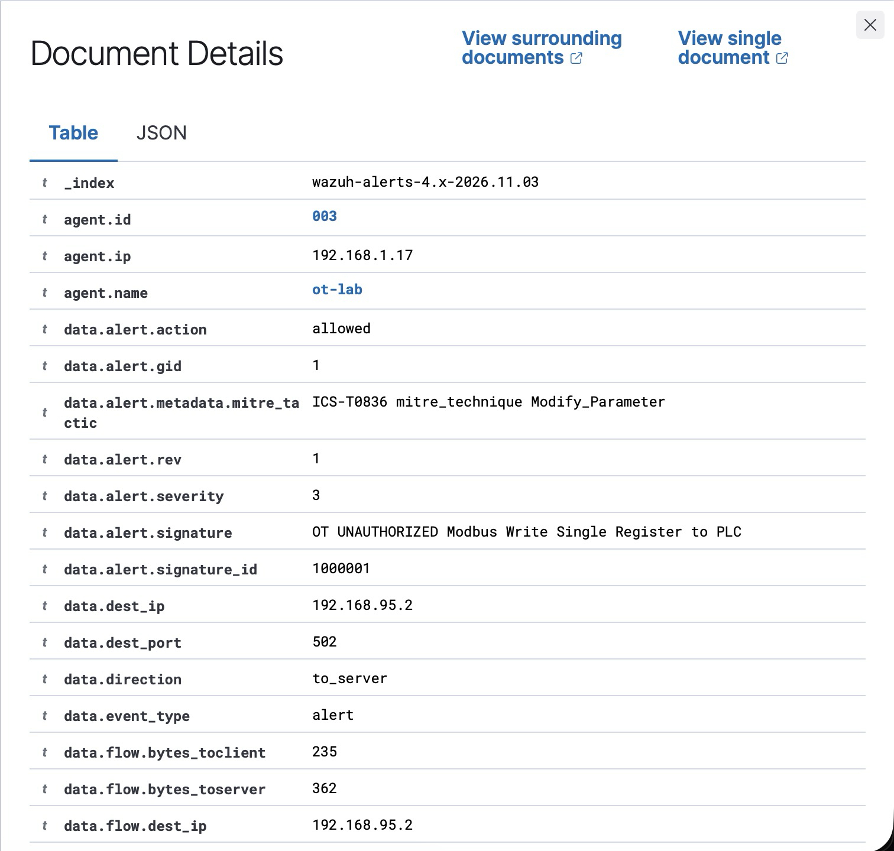
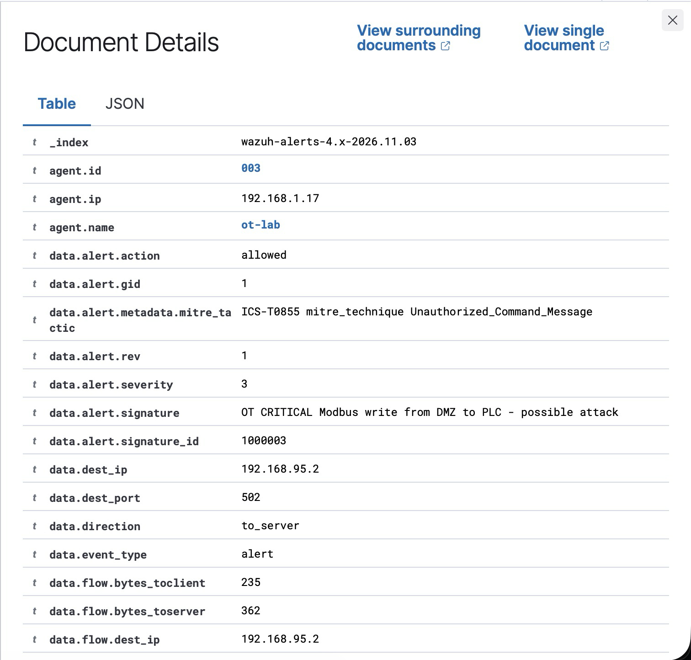

# OT Security Lab: ICS Attack & Detection

Hands-on industrial control system (ICS) security lab built on
[GRFICSv3](https://github.com/Fortiphyd/GRFICSv3) by Fortiphyd Logic,
running in Docker on a Proxmox VM. This project simulates a chemical
plant, carries out a Modbus attack against the PLC, and detects it
with a Suricata rule mapped to MITRE ATT&CK for ICS.

## What this demonstrates
- Mapping an OT network across ICS and DMZ zones (Purdue model)
- Baselining normal Modbus/TCP traffic
- Executing an unauthenticated Modbus write against a live PLC
- Observing physical process impact in the operator HMI
- Writing a network detection and confirming it fires on the attack

## Lab environment
- Host: Proxmox VE, Ubuntu 24.04 VM (4 vCPU, 12 GB RAM)
- GRFICSv3 containers: simulation, PLC (OpenPLC), HMI (Scada-LTS),
  engineering workstation, router, Kali attacker, Caldera
- Change from upstream: macvlan parent set to the VM's NIC (ens18)

## The target process
The lab models the Tennessee Eastman chemical process. The PLC
controls feed, purge, and product valves to hold reactor pressure
in a safe range.

**OpenPLC controller running the Chemical Reactor program:**

## The attack
From the Kali attacker in the DMZ (192.168.90.6), an unauthenticated
Modbus write (function code 6) was sent to the PLC (192.168.95.2)
across the router. Modbus/TCP has no authentication, so the PLC
accepted it as legitimate. This maps to MITRE ATT&CK for ICS
**T0855 (Unauthorized Command Message)** and **T0836 (Modify Parameter)**.

**Operator HMI — valves under automatic control:**

**Operator HMI — purge valve forced to 0% by the unauthorized write:**

## The detection
A Suricata rule monitors the ICS network for Modbus write function
codes directed at the PLC, flagging writes sourced from the DMZ.
On the live attack it fired immediately:

See [`detections/ot-modbus.rules`](detections/ot-modbus.rules) and the
documentation in [`docs/`](docs/).

## Documentation
- [01 Network map](docs/01-network-map.md)
- [02 Traffic baseline](docs/02-traffic-baseline.md)
- [03 Attack](docs/03-attack.md)
- [04 Detection](docs/04-detection.md)

## Next steps
- Forward Suricata alerts into a Wazuh SIEM for centralized detection
- Drive reactor pressure past its safety trip to demonstrate physical impact

## Credits
Built on [GRFICSv3](https://github.com/Fortiphyd/GRFICSv3) by
Fortiphyd Logic. Simulation and container images are their work.

## SIEM integration (Wazuh)
Suricata alerts are shipped by a Wazuh agent on the OT lab VM to a
central Wazuh manager, where they are decoded and surfaced as SIEM
alerts — the same way a real OT SOC centralizes detections.

**Both OT attack alerts in the Wazuh dashboard (agent: ot-lab, rule 86601):**

**Alert detail — unauthorized Modbus write, with source IP and MITRE mapping:**

Full pipeline: Kali (DMZ) → PLC → Suricata (ICS sensor) → Wazuh agent →
Wazuh SIEM, tagged with MITRE ATT&CK for ICS T0836 and T0855.

## SIEM integration (Wazuh)
Suricata alerts are shipped by a Wazuh agent on the OT lab VM to a
central Wazuh manager, where they are decoded and surfaced as SIEM
alerts — the same way a real OT SOC centralizes detections.

**Both OT attack alerts in the Wazuh dashboard (agent: ot-lab, rule 86601):**

**Alert detail — unauthorized Modbus write, with source IP and MITRE mapping:**

Full pipeline: Kali (DMZ) → PLC → Suricata (ICS sensor) → Wazuh agent →
Wazuh SIEM, tagged with MITRE ATT&CK for ICS T0836 and T0855.
